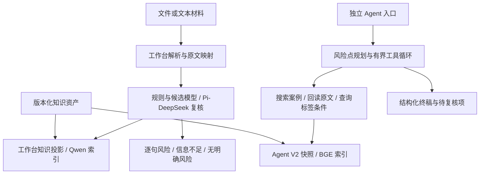

# 架构与整合边界

## 业务流程

监管材料采集与结构化 → 版本化知识资产 → 混合检索 → 营销材料风险初筛 → 原文证据与待复核条件。

知识维护另行执行提议、独立核读、人工审核、构建和选版；候选不自动变成正式知识。

## 两个模块

| 模块 | 服务与入口 | 检索 |
|---|---|---|
| `apps/workbench` | FastAPI / Web，`/api/query/analyze/text`、`/api/query/analyze/file` | BM25 + Qwen，RRF融合，可选重排与pre/post/adaptive时机。 |
| `apps/agentic-rag` | Python来源服务 + TypeScript / Pi；`POST /api/agent-rag/tasks`及任务查询接口 | 默认mock演示使用BM25；完整V2使用BM25+BGE、RRF、DeepSeek重排。 |

根目录 `finrisk.py` 只负责选择应用、定位目录和传递启动参数。应用各自的代码、依赖、测试、数据目录和启动器都留在模块内，避免同名 Python 包及索引配置冲突。

## 证据约束

- 当前材料中的行为和背景决定风险是否成立；相似案例只是参照。
- 来源通过稳定 ID、文本哈希与原文区间绑定；格式或哈希校验不能证明语义正确。
- 缺事实、执行失败和“无明确风险”分别保留。
- Qwen与BGE分别维护索引，模型空间和指纹不混用。
- 来源文书、主体案例、行为与检索单元分别统计。

## 进一步统一审查入口

当前已完成仓库、项目说明与启动入口整合。跨模块任务适配尚未实现，需要先处理：

1. 工作台同步响应与Agent异步任务之间的状态转换。
2. 工作台文本上限1,000,000与Agent请求上限10,000的差异；超长材料不得静默截断。
3. Agent风险点、来源ID与工作台原句和文件位置的映射。
4. 业务判断与任务失败、未完成核查的独立状态。
5. 输入、字典、知识、模型和索引的版本绑定。

原始详细设计分别保留在[工作台架构](../apps/workbench/docs/architecture.md)和[Agent架构](../apps/agentic-rag/docs/ARCHITECTURE.md)。
