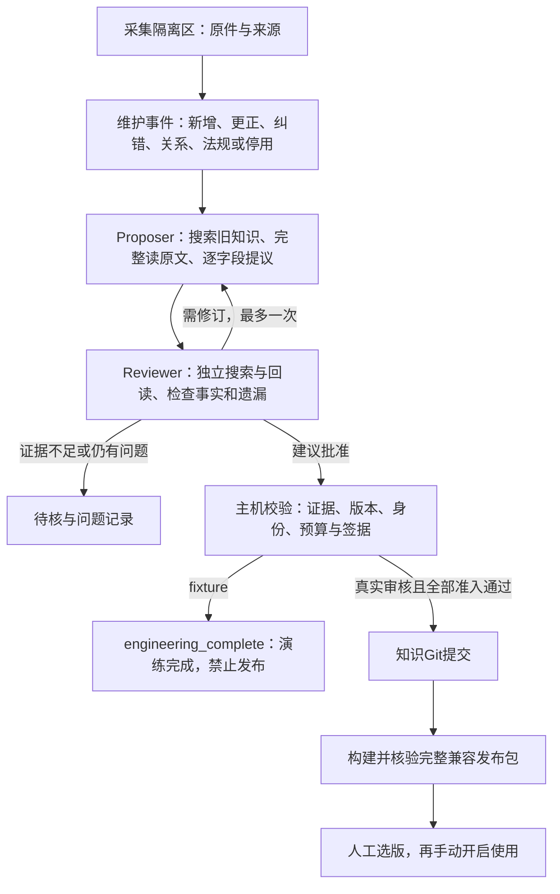

# Proposer–Reviewer知识维护：首期工程实现

> 公开包说明：本文涉及的真实V2规模和既有库存属于研发环境。公开仓库只包含代码及合成夹具，默认未绑定真实V2；使用者需提供自己的兼容资产。真实维护适配器与完整生产构建器仍未配置。

本模块从独立验证副本按模块整合到当前主项目，提供维护专用的事件、工具Agent、审核协议、共享预算和发布门禁，保留主Agent现有证据反馈循环。当前可用于零收费工程回放，以及登记实际采集文书的待审事件。**真实双模型自动审核与生产发布尚未配置，页面明确禁用；不是已上线的自动更新系统。**

## 处理流程



图中真实批准、构建和选版由受控类提供接口及负例测试；当前MaintenanceService只运行fixture分支，不会调用后半段生产链路。周期整理可登记事件，本轮未执行全库语义整理。

## 已实现的控制

| 部分 | 实际行为 |
|---|---|
| 三层存储 | 原始字节与抽取文本分别取SHA并保留；知识Git保留记录和审核历史；服务资产由统一清单约束 |
| 维护事件 | 新增、同源更正、抽取纠错、重复关系、法规修订、停用、冲突和周期整理；幂等登记 |
| 独立Agent | 安装的Pi核心实际执行工具循环；提议和审核独立上下文；审核者不能写提议，提议者不能签审核 |
| 十个工具 | 知识搜索、原件搜索、原文读取、记录读取、版本比较、依赖查询、变更读取、白名单检查、提议、审核建议 |
| 证据 | Unicode码点左闭右开坐标；逐字引用和SHA校验；服务端计算完整阅读覆盖，搜索预览不计全文已读 |
| 内容约束 | 官方27标签、最多3个；区分检索假设与原文确认；保留条件、否定、例外、未知；法规效力和日期不明不得当现行规则 |
| 额度 | 同一SQLite批次账本；事件、阶段、角色和批次同时限额；已发未知结果保留预留，不自动重试或重开账本 |
| 停止与并发 | Proposer最多2个，Reviewer最多1个，初次与修订共用限制；最多一次修订；取消、无进展、超时或超限停止 |
| 审核签据 | 主机签发，绑定变更、证据、基础提交、字典、提示和工具；模型自填approve不算批准；fixture签据生产必拒 |
| 版本与发布 | 本地受控知识Git；完整13类资产及主机内容验证器；缺构建器明确blocked；使用与选择分开；只允许已登记完整发布回滚 |
| 批准历史 | 合入与构建逐段核验整个知识提交链；只锚定严格空初始化或主机登记的精确旧库导入SHA，不能通过后续合法修改带入未审祖先 |
| 旧入口 | 原生成CLI只产候选；`--publish`拒绝；管理页加工转成待审登记；历史未审选版不能绕过读取门禁 |
| 管理界面 | 本机同源与CSRF保护，查看事件、修订差异、模型建议和资源；模型审核、工程回放与人工审核分开显示 |

授权搜索覆盖已绑定知识和注册证据，不限制为某个Top-K候选片段。当前维护搜索是本地词项匹配与分页，**不是在线风险检索的BM25+BGE/RRF/DeepSeek链路**。该在线检索配置未改动。当前read_record可能返回整条记录；原件支持每次最多6000码点的分页回读。

默认事件上限28个模型请求、88次工具操作、900秒；单模型请求最多90秒。四阶段请求上限为8/10/4/6，工具上限24/32/12/20。令牌保护采用保守UTF-8字节上界加输出预留，跨角色累计不超过24万单位且不退款；这不是实际token计费值。真实适配器还必须配置已核验的模型窗口、输入上限与计价依据。

## 使用入口

既有启动方式不变，本机管理页为 `/agent-rag/knowledge`。历史导入和采集仍只保存原件；“登记维护事件”不会收费或创建可选版本。已绑定可信构建配置时，导入前将旧V2快照导入维护只读视图，旧数据保留`legacy_candidate`身份。没有配置时可先登记原件，但不能宣称已具备旧全库核查能力。

实际运行数据保存在项目`runtime/knowledge_updates/maintenance/`；原件、SQLite、签名密钥和业务轨迹不随代码提交。密钥只由主机读取，Agent子进程不继承模型密钥及Git配置。不要删除账本后重跑未知费用作业。

主项目现用基线为9,640份来源、65,478条结构单元，绑定时必须核验主机固定的manifest SHA，不能带入源副本的旧基线。只读维护视图由实际绑定操作生成；库存迁移不等于已完成全库审核。来源包装是完整文书视图，不等同于单一受罚主体案件；旧数据保持`legacy_candidate`身份，不冒认为人工批准。旧导入锚必须使用最初登记的SHA及可信manifest pin，不能把最新head自动视为批准版本。

可重复工程回放（在仓库根目录执行；输出目录必须为空）：

```powershell
npm --prefix 'agent_harness' run build
& '.agent-venv/Scripts/python.exe' 'scripts/evaluate_knowledge_maintenance.py' --suite smoke --output 'runtime/maintenance-smoke-new'
& '.agent-venv/Scripts/python.exe' 'scripts/evaluate_knowledge_maintenance.py' --suite full --output 'runtime/maintenance-full-new'
```

工程报告包含真实Node进程轨迹、工具调用、修订、签据、费用与预留账本。夹具答案是预定脚本，不能用作真实模型准确率。详见[回放说明](KNOWLEDGE_MAINTENANCE_REPLAY.md)。本轮实际验证以当前整合日志为准，不沿用来源副本的验收数字或报告。

## 启用真实维护前的剩余事项

1. 核定Proposer和异源Reviewer的实际模型、发送范围及总费用；注册两个经验证的原生工具适配器。现有CLI明确拒绝live，不能只改`live=true`或填写model_id绕过。
2. 接入全部服务资产的真实构建器和内容验证器，包括法规、指南/关系、双路检索、向量行映射、阅读、权限与活动集合。法条更正、停用须验证召回、重排前准入及缓存一致；当前尚未把新维护提交用于线上召回。
3. 将现有法规库、指南和关系资产按真实布局绑定为维护知识，并核验稳定ID、原件来源、时间和依赖。首期旧V2绑定仅覆盖案例及行为投影，不能代表法规库已重审。
4. 运行20条真实/注入故障对照试点及固定检索集回归，分别报告遗漏、误放、待核、费用与耗时；工程模拟成绩不能代替这一步。
5. 补充可控断点恢复策略及周期整理覆盖台账。当前持久化状态、租约和预算支持核对，已完成事件重放不重复调用；管理API的resume明确返回409，不能自动续跑未明状态。

上述事项应在真实供应商和资产验证后逐项开启。当前基线仍可只读使用，新增候选不会自动与基线一起参与审查。
